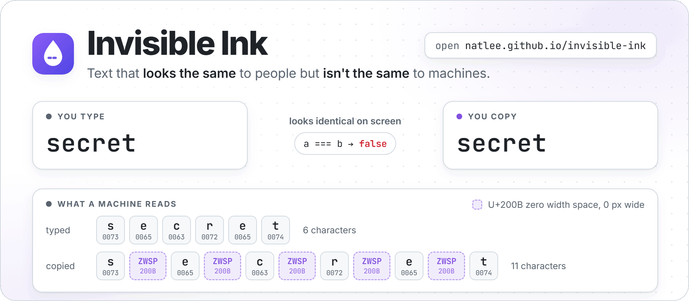
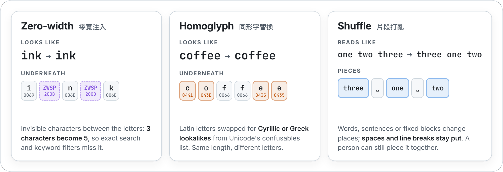
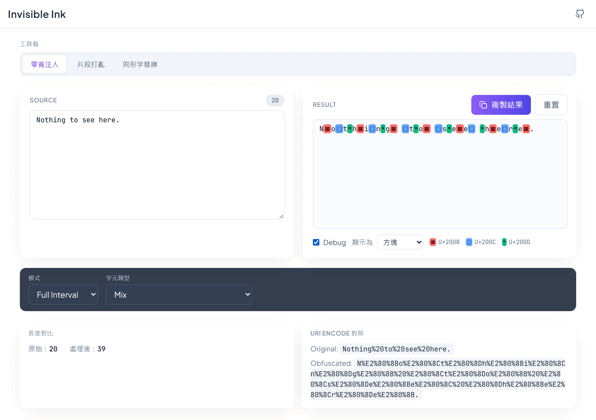

<p align="center">
  <picture>
    <source media="(prefers-color-scheme: dark)" srcset="docs/images/hero-dark.png">
    
  </picture>
</p>

<p align="center">
  <a href="https://github.com/NatLee/invisible-ink/actions/workflows/ci.yml"></a>
  <a href="https://natlee.github.io/invisible-ink/"></a>
  
  
  
</p>

Invisible Ink (隱形字元注入器) rewrites a piece of text so that it still **looks the same to people but
is a different string to machines**. It can slip zero-width characters between the letters, swap Latin
letters for Cyrillic or Greek lookalikes, or shuffle the words around. Use it to see how your own search,
filters, forms or scrapers cope with hidden characters, to teach how Unicode tricks work, or to make naive
copy-and-paste bots stumble.

**Try it at [natlee.github.io/invisible-ink](https://natlee.github.io/invisible-ink/).** It is a static
page: everything runs in your browser and nothing you type is sent anywhere.

## The three tools

<picture>
  <source media="(prefers-color-scheme: dark)" srcset="docs/images/tools-dark.png">
  
</picture>

Pick a tool from the tabs at the top (工具箱). The labels in the app are in Chinese, so they are listed
next to the English names below.

### Zero-width (零寬注入)

Inserts characters that take up no space. The text looks unchanged, but it no longer matches the
original in a search, a comparison or a keyword filter, and many apps stop recognising a URL as a link.

| Mode (模式) | Where the invisible characters go |
|---|---|
| Full Interval | between every pair of characters |
| Random | in each gap with the chance you set on the density slider (密度, 0–100%) |
| Space Only | after every space, tab and line break |
| URL Breaker | after every `:`, `.` and `/` |

The character type (字元類型) is U+200B zero width space (the default), U+200C zero width non-joiner,
U+200D zero width joiner, or Mix, which rotates through all three. An emoji, a flag or a letter with an
accent counts as one character, so it is never split in half.

Tick **Debug** to see what is hidden: 編碼標記 shows each one as `<200B>`, 方塊 draws a coloured block
(in Mix, one colour per character, with a legend). The panels under the options compare the length and
the `encodeURIComponent` output of the original and the result.

<p align="center">
  
</p>

### Homoglyph (同形字替換)

Replaces Latin letters with Cyrillic or Greek letters that look the same, like Cyrillic `а` for `a`.
Every pair is taken from Unicode's [confusables list](https://www.unicode.org/Public/security/latest/confusables.txt)
(the security data browsers use to spot lookalike domain names), so the result reads as the same word.
Each letter gets a random pick from its lookalikes, and the length never changes.

| Strength (替換強度) | Letters it replaces |
|---|---|
| 最小 minimal | a e o A E O |
| 中等 medium (default) | a c e o p r s x y and A C E K O P S X Y |
| 完整 full | a c e o p r s u v w x y and A B C E H K M O P S T X Y |

Letters with no listed lookalike (for example `k`, `n`, `R`) are left alone.

### Shuffle (片段打亂)

Reorders pieces of the text. Unlike the other two tools, the change is visible, but the pieces are all
still there, so a person can work it out while a program comparing text sees something else.

| Split by (切分方式) | What moves |
|---|---|
| 依單字 word | words; spaces, tabs and line breaks stay where they were |
| 依句子 sentence | sentences, each with its own `.` `!` `?` `。` `！` `？`; every line counts as a sentence |
| 固定字元區塊 fixed blocks | blocks of 2 to 8 characters (區塊大小 slider) |

When there are at least two different pieces, the result is never the original order.

**Copy** (複製結果) puts the result on the clipboard, **Reset** (重置) clears the text and puts every
option back to its default.

## Undoing it

None of this is encryption, and it is easy to reverse once you know what to look for. In JavaScript:

```js
const copied = "s\u200Be\u200Bc\u200Br\u200Be\u200Bt"; // what Invisible Ink gives you for "secret"

copied === "secret"           // false
copied.length                 // 11
copied.includes("secret")     // false

const cleaned = copied.replace(/[\u200B-\u200D\u2060\uFEFF]/g, "");
cleaned === "secret"          // true

const homoglyph = "\u0441\u043Eff\u0435\u0435"; // "coffee" after the homoglyph tool (medium)
homoglyph === "coffee"        // false
/[^\x00-\x7F]/.test(homoglyph) // true: there are non-ASCII letters in an "English" word
```

For homoglyphs in general, map the text to its confusables "skeleton" as described in
[Unicode TS #39](https://www.unicode.org/reports/tr39/#Confusable_Detection) before comparing.

## Limitations and fair use

- **It hides text from simple checks, not from people.** Anything that strips zero-width characters or
  normalises lookalikes sees the original again. Some apps and websites already strip them when you paste.
- **U+200C and U+200D are not always invisible.** They control how letters join, so in Arabic, Persian,
  Indic scripts and emoji they can change how the text looks (U+200D between two emoji may merge them into
  one). U+200B is the safe choice for those.
- **It can hurt accessibility.** Screen readers may spell out text with lookalike letters or stop at the
  hidden characters, and the text won't show up in other people's searches.
- **Length counts UTF-16 units**, like JavaScript's `length`: an emoji counts as 2. The source box takes up
  to 10,000 of them; longer pastes are cut at that point.

Please use it on your own text and systems. Don't use it to impersonate people, build lookalike links,
or sneak content past spam filters and moderation you are supposed to follow.

## Development

You need [Node.js](https://nodejs.org/) 22 (CI uses 22).

```bash
git clone https://github.com/NatLee/invisible-ink.git
cd invisible-ink
npm ci
npm run dev
```

Then open <http://localhost:3000/invisible-ink/>. The app lives under `/invisible-ink/` even locally,
because that is its path on GitHub Pages (`basePath` in [`next.config.mjs`](next.config.mjs)), so
`http://localhost:3000/` gives a 404.

Before sending a change, run the same checks as CI:

```bash
npm run lint        # ESLint 9 (eslint .)
npm run typecheck   # tsc --noEmit
npm test            # Vitest unit tests for lib/
npm run build       # static export to out/
```

The text tools are plain functions in `lib/` with no React in them, so they are easy to test:

| File | What it does |
|---|---|
| `lib/injector.ts` | `injectZeroWidth()` and the Debug view helpers |
| `lib/homoglyph.ts` | `applyHomoglyph()` and the lookalike table |
| `lib/shuffle.ts` | `shuffleFragments()` |
| `lib/text.ts` | shared helpers: split into whole characters, safe URI encoding |
| `app/page.tsx` | the page; `components/` holds the panels and controls |

The README images are made from `docs/images/src/` (HTML rendered with a headless browser, plus a
screenshot script); the comments at the top of each file say how.

## Deployment

[`.github/workflows/ci.yml`](.github/workflows/ci.yml) runs lint, type check, tests and the build on every
pull request. On a push to `main` it also uploads `out/` and deploys it to GitHub Pages. For that, the
repository's **Settings → Pages → Build and deployment → Source** has to be **GitHub Actions**.

If you fork it under another name, change `basePath` in `next.config.mjs` to `/<your-repo-name>`.

## License

[MIT](LICENSE) © 2026 Nat Lee
